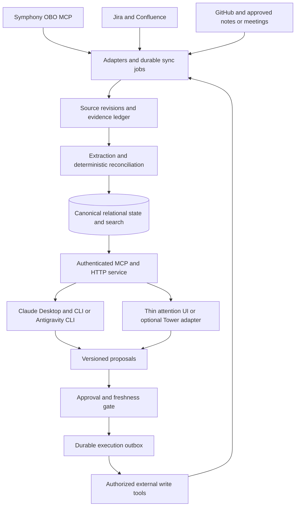
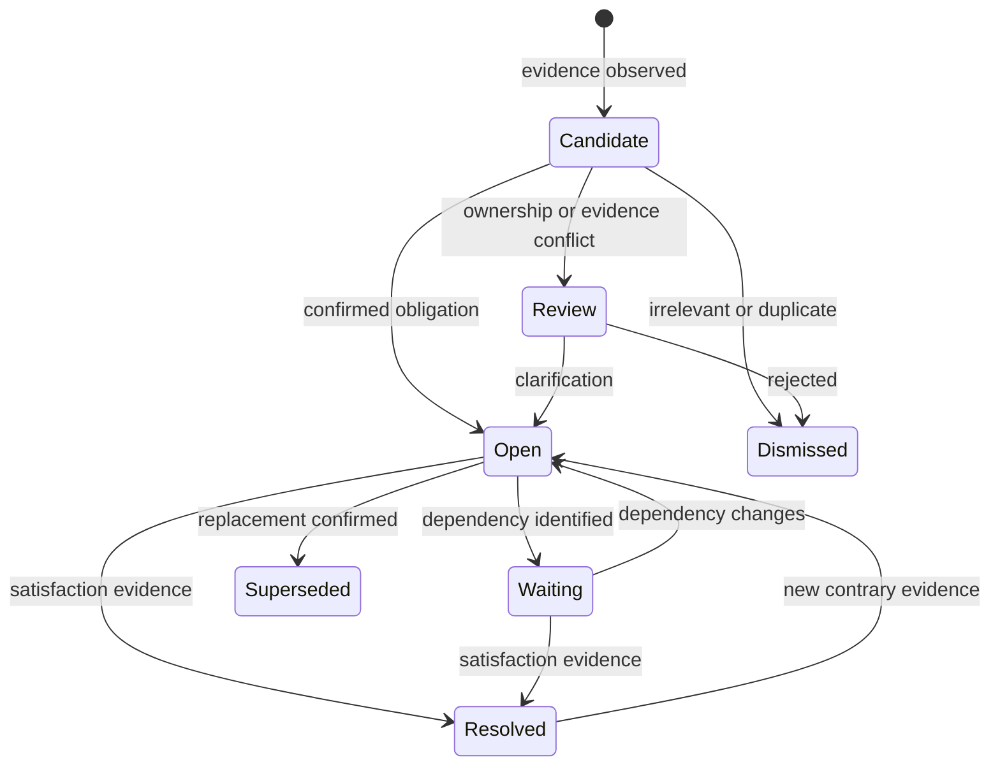

# Work Copilot Architecture

A lightweight work chief of staff that remembers project context, catches obligations, and prepares grounded responses without becoming your primary workspace.

**Status: architecture proposal, not an implementation.** This document proposes a public-safe design. Product integrations, API capabilities, deployment choices, and latency targets require verification. All examples are fictional. Nothing here authorizes connecting work accounts, deploying software, or sending messages.

## Recommendation

Keep Claude Desktop, Claude CLI, and Antigravity CLI as the places where you think, write Markdown, design, code, and invoke MCP tools. Add one small coordination service that maintains durable project memory and an attention queue. Expose the same service through MCP and authenticated HTTP. A thin visual interface—potentially an adapter in your Tower fork—shows what needs attention and lets you inspect evidence, revise drafts, and approve actions.

The interface is a **glanceable companion, not a replacement workspace**. Closing it must not stop synchronization. Switching agents must not lose context. A CLI correction and a visual correction must update the same operational record.

**Your brain lives in one work-context service, not in the UI, a chat history, or a folder of PDFs.** It owns project relationships, evidence-backed facts, commitments, open questions, and prior responses. MCP and HTTP are interfaces to that brain, not storage or memory themselves.

Recommend an approved company always-on host using an existing PostgreSQL database when available, plus a worker and approved object storage for permitted artifacts. A local SQLite prototype is valid; neither a new managed platform nor a graph database, vector infrastructure, or agent swarm is required.

## The daily experience

Open a compact attention view with three sections: **Needs you**, **Waiting**, and **Recently changed**. Each card shows the project, reason for attention, ownership uncertainty, deadline, freshness, and evidence. This is also the single control center for editing relationships, resolving conflicting facts, correcting ownership, and inspecting coverage; it does not become the primary authoring workspace. Use restrained typography, generous whitespace, keyboard navigation, and text labels rather than color alone.

A card might say: “Atlas release question has no reply; deployment status changed after the draft.” Expanding it reveals the conversation, current project state, draft, and what would happen on approval. Dismiss, snooze, correct, or approve without navigating a new project-management system. Snoozing changes visibility, not the underlying obligation.

Ask your preferred agent: “What changed on Atlas?” or “Help me answer this room.” It retrieves the same project snapshot and queue state, then uses its existing coding and authoring capabilities. The companion presents concise context and opens authoritative tools when deeper work is needed.

## System boundaries



The backend connects to existing source MCPs through capability-checked adapters and owns scheduling, identity, synchronization, reconciliation, policy checks, and audit history. Models extract candidates, explain evidence, and draft responses; they do not independently own truth or silently perform side effects. UI and CLI clients share API contracts rather than implementing separate policies.

| Information | Authority | Copilot responsibility |
| --- | --- | --- |
| Engineering issue state | Jira | Mirror references and detect obligations or conflicts |
| Team specifications and decisions | Designated Confluence documents | Retrieve cited revisions; propose changes |
| Code and reviewed changes | GitHub repository | Link commits, pull requests, checks, and handoffs |
| Personal working notes | Approved Obsidian vault | Read selected notes; export clearly labeled views |
| Conversation and meeting evidence | Original permitted sources | Preserve provenance and reconcile later developments |
| Attention, candidate obligations, approvals | Coordination service | Maintain one canonical operational state |

A personal note cannot silently override a Jira status. A conversation may provide newer evidence but should create a conflict or proposed update, not rewrite the authoritative system. Obsidian exports are projections; edits intended as corrections must pass through the service with revision checks. Avoid two independently editable task lists.

## Capture without pretending to see everything

The assumed Symphony OBO integration can read, send, and create rooms at the user's permissions. That assumption comes from the proposed use case, not an independently verified capability contract. OBO permissions describe what a credential can do; they are **not blanket authorization to send or create rooms**.

Before implementation, verify room discovery, membership visibility, history access, pagination, message identifiers, revision timestamps, edit/delete behavior, rate limits, and send-result semantics. MCP is a tool interface, not inherently a push event bus. Confirm whether scheduled polling is permitted and supported; use approved notifications or webhooks only if actually available. Do not assume bot Datafeed coverage applies to an OBO identity.

Connector-specific starting points are [Jira Cloud webhooks](https://developer.atlassian.com/cloud/jira/platform/webhooks/) and [Confluence Cloud CQL search](https://developer.atlassian.com/cloud/confluence/advanced-searching-using-cql/). Cloud versus Data Center deployment is unresolved; these references do not establish availability in a particular installation. [Obsidian properties](https://obsidian.md/help/properties) can carry stable project IDs in selected notes. For a Google Meet adapter, [artifact retrieval](https://developers.google.com/workspace/meet/api/guides/artifacts) covers generated meeting artifacts; their existence, user access, and permission to process them must be established, not assumed.

For every adapter:

1. Define an explicit scope: allowed rooms, projects, repositories, note folders, and meeting sources. Discover additional rooms only within approved permissions and selection rules.
2. Backfill a bounded history window, following all pages. Record coverage start/end, gaps, and unsupported capabilities.
3. Poll incrementally using provider cursors where reliable, with an overlap window to catch late events. Deduplicate by source identity and revision, not prose similarity alone.
4. Atomically commit ingested records and the corresponding checkpoint. A crash before commit must replay safely; a checkpoint must never advance past uncommitted records.
5. Reconcile edits, deletions, timestamp changes, and out-of-order events. If deletion detection is unavailable, mark that limitation and perform supported periodic rechecks rather than implying completeness.
6. On detected access loss, immediately stop ingestion and retrieval, invalidate dependent drafts, and apply approved retention/deletion policy to cached content and derived material. Revalidate access before serving restricted content or executing actions; fail closed when permission cannot be established. Record ACL check time and detection limitations rather than claiming instantaneous knowledge of upstream revocation.

Process permitted room summaries even when the user is not tagged. “We still need someone to confirm the release checklist” is an obligation candidate, not proof that the user owns it. Room activity is not automatically personal responsibility.

Every view reports **last successful sync and coverage**, not merely when its summary was generated. “No outstanding requests found” must be qualified by the sources and period examined. Proposed pilot targets might be a five-minute poll interval, a ten-minute observation-to-queue p95, and a cached context response within two seconds. These are SLOs to measure, not guarantees; rate limits, outages, approval requirements, and model latency may require different targets.

## Where the brain lives

Run one coordination service on an approved always-on company host, with existing PostgreSQL for transactional state and approved object/blob storage for permitted transcripts and artifact versions. This keeps capture available when a laptop sleeps and gives every client the same durable context. Choose existing supported infrastructure rather than requiring another managed platform. The host, models, encryption, retention, backup, and network access need organizational approval.

A local single-user pilot can use SQLite with full-text search on persistent disk, one service writer, and tested backups. Do not share a live database by copying it through a sync folder or letting clients write independently. A sleeping laptop cannot provide continuous capture; show the resulting coverage gap and backfill on resume. Move the same logical model to the approved host if continuity is needed.

Separate four storage layers:

1. **Upstream authority:** Jira, Confluence, repositories, conversations, and designated notes retain their authoritative records.
2. **Source ledger:** retain stable locators, revisions, hashes, access scope, and minimal permitted snapshots. Version evidence rather than overwriting history, subject to deletion and retention policy.
3. **Canonical relational brain:** entities, relationships, facts, decisions, obligations, approvals, and execution outcomes are transactional records with provenance.
4. **Rebuildable projections:** project briefs, full-text indexes, optional semantic recall, and UI cards derive from those records. They are never a second authority.

An illustrative private object layout is `sources/<provider>/<object-id>/<revision>/` and `projects/<project-id>/artifacts/<artifact-id>/<version>/`. These are storage locations, not the ontology: database links connect an artifact to multiple relevant entities without copying it. Source payloads, credentials, and databases must never enter the public repository.

Obsidian remains a human-authored personal knowledge space. Only explicitly selected folders participate as inputs or projections; unrelated local notes do not automatically synchronize to company infrastructure. A local cache is optional, scoped, and revocable.

## A small project ontology

Use stable internal IDs for **Project, Workstream, Person, Conversation, SourceObject, Commitment, Decision, Fact, and Artifact**. A workstream groups a project's ongoing track of work; a commitment represents an obligation rather than every mentioned task. Typed relationships express ownership, participation, dependencies, support, and supersession.

External provider IDs identify objects within a provider and tenant/workspace/account namespace; use that full identity in uniqueness constraints, checkpoints, and deduplication. Contextual aliases help find them. A room title, project nickname, or person's display name is not a globally unique identity. Map a project explicitly to Jira keys, repository IDs, rooms, documents, and selected note paths. Ambiguous mappings require review. Entity merges preserve the original IDs and evidence, are recorded, and can be reversed.

Facts carry the assertion, subject, scope, source revision, observation time, effective validity interval when known, confidence, and verified/conflicting/superseded status. Distinguish source-stated facts, model-inferred candidates, and user-confirmed state. New evidence can update validity without erasing history; forgetting, deletion, and access revocation propagate to summaries, indexes, caches, and affected drafts under policy.

The project brief is a rebuildable view of purpose, current phase, decisions, open issues, obligations, and contradictions. Important assertions retain evidence and freshness. Summaries cannot recursively confirm themselves. Weeks of continuity come from reconciled records, not a growing chat transcript.

Reconciliation uses stable keys and explicit transitions. Repeated meeting summaries and a Jira issue can support one obligation without producing three tasks. Link their evidence while preserving source distinctions. A later reply can satisfy a request; a subsequent clarification can reopen it. A changed deadline retains its previous value and supporting revision. Uncertain ownership remains uncertain until resolved.



An obligation's lifecycle is separate from a message draft's lifecycle. Sending an acknowledgement does not resolve the underlying work. A resolved issue does not prove every related question was answered.

## Grounded replies that sound useful

The service compiles context rather than asking each client to reconstruct everything:

1. Resolve the requesting identity, permissions, project, and intent.
2. Fetch fresh authoritative state, canonical open questions, prior outgoing answers, relevant commitments, and decisions.
3. Assemble a bounded evidence packet with source revisions, freshness, conflicts, and explicit gaps. Use exact identifiers and full-text retrieval first; expand only when needed.
4. Let the chosen client reason, code, design, or draft in its existing workspace.
5. Accept structured proposed changes and confirmed tool receipts back into the service. A client's statement that work is done is not a substitute for source evidence.

Keep one canonical obligation per distinct request or intent, not one per entire conversation; a room or thread may contain several independent requests. Each record links the original request, clarification questions already asked, answers received or sent, and unresolved intent using source message references. Before suggesting another question or reply, check that record and the current conversation. This reduces repeated questions and unnoticed unanswered requests within observed coverage without assuming that every read message needs a response. There is no promise of completeness outside declared coverage.

Choose a response mode before writing:

| Mode | Purpose | Constraint |
| --- | --- | --- |
| Acknowledge | Confirm receipt of a support request | No invented investigation, owner, deadline, or promise |
| Status | Explain established progress | Cite current evidence; distinguish planned from completed |
| Clarify | Resolve a material ambiguity | Ask the smallest question needed |
| Defer | Explain that a reliable answer is not yet available | State the gap without fabricating an ETA |

For example: “Thanks for flagging this. Which environment shows the error?” is safer than “I'm investigating and will fix it today” when neither investigation nor timing is established. Even acknowledgements remain drafts unless separately authorized.

Keep an internal evidence ledger separate from outgoing prose. Record which source supports each material claim, contradictions checked, missing facts, and the snapshot revision used. The user can inspect it; recipients receive only appropriate content and citations they are authorized to see. Never include inaccessible source excerpts just because the assistant can retrieve them.

Learn tone from user-approved examples and explicit preferences, not private messages indiscriminately. Style can change phrasing; it cannot create facts or commitments. Version skills and runbooks as reusable procedures with owners and review dates. Store project facts in evidence-backed memory, not in skills that silently become outdated.

## Approval and execution safety

Read-only capture, inference, and draft preparation are distinct from writes. Sending a message, creating a room, modifying Jira, editing a shared document, or publishing code requires the applicable approval policy. The initial pilot enables no external writes. Reviewing or dismissing an attention card is not approval to execute.

An approval binds an exact proposal revision, content hash, destination identity, action type, relevant attachments, and expiry. For a new room it also binds membership and visibility. Editing text, changing recipients, or acquiring material new evidence invalidates approval. Immediately before execution, recheck authorization, source freshness, destination permissions, and duplicate intent.

Deduplicate against the canonical conversation intent and prior outgoing answers. Persist the intent and idempotency key before sending. Use provider idempotency where supported. A timeout after submission is **unknown outcome**, not failure: reconcile via returned IDs, provider lookup, or operator review before retrying. Never blindly resend a message. Record the observed result separately from the attempted action; an API acceptance is not always delivery confirmation.

Treat all retrieved text—including messages, documents, code comments, and meeting transcripts—as untrusted data. Embedded instructions cannot change system policy, request credentials, authorize writes, or expand access. Keep credentials out of model context and logs. Enforce ACLs during ingestion, retrieval, drafting, preview, and execution; derived summaries must retain source sensitivity. Revocation must propagate to indexes, caches, exports, and drafts under the retention policy.

Use an approved runtime and model for the data classification involved. Do not assume that an individual's technical access permits sending work content to any model provider. Log policy decisions and action metadata with minimized sensitive payloads. Protect the local database, backups, and service endpoint; bind locally by default unless remote access is explicitly approved.

## A small buildable shape

The following is a logical layout, not files or commands already installed:

```text
service/
  adapters/         # Capability contracts and source normalization
  sync/             # Scheduling, checkpoints, retries, coverage
  reconcile/        # Identity mapping and state transitions
  retrieval/        # ACL-filtered project context and FTS
  proposals/        # Draft revisions and evidence ledger
  policy/           # Approval, access, freshness, execution gates
  api/              # Shared MCP and HTTP contracts
ui/                 # Standalone view or optional Tower adapter
skills/             # Versioned procedures, not project facts
fixtures/           # Synthetic sources and replay expectations
private-runtime/    # Database, cache, outbox; never committed
```

Minimum logical records:

| Record | Essential fields |
| --- | --- |
| `project` / `source_binding` | Stable ID, aliases, source IDs, approved scope |
| `source_revision` | Provider/tenant-or-account/object/revision keys, timestamps, hash, locator, ACL, tombstone |
| `sync_checkpoint` | Scope, cursor, covered interval, last success, gap/error |
| `evidence` / `claim` | Source references, assertion, confidence, validity, supersession |
| `obligation` | Project, owner certainty, state, due-date evidence, revision |
| `proposal` / `approval` | Action, destination, exact content hash, evidence snapshot, expiry |
| `execution` | Idempotency key, attempt state, provider receipt, reconciliation result |
| `artifact` / `handoff` | Version, path/hash, project, source snapshot, session summary |

Use foreign keys, uniqueness constraints, transactions, migration versions, and optimistic concurrency. Serialize conflicting updates through the service. Preserve audit transitions while applying retention requirements to sensitive payloads. Test backup and restore rather than assuming a database file alone is sufficient.

Conceptual MCP operations include `project_context`, `attention_list`, `obligation_correct`, and `proposal_create`. A separate `proposal_approve` boundary requires an authenticated, authorized human approver; model/tool credentials cannot self-approve or manufacture approval. Record the approver identity separately from the execution identity, and verify both approval authority and execution permissions. Read, proposal, approval, and execution scopes must be separate. Equivalent HTTP routes serve the UI; neither client directly edits the database.

A coding-session handoff records project ID, repository and branch, relevant commit, changed files, tests actually run, unresolved questions, artifacts, and next proposed action. Store concise evidence-linked summaries, not hidden reasoning. The next CLI session retrieves this handoff and verifies repository state before acting.

Artifacts have immutable versions and explicit draft/approved/published status. Markdown, designs, and generated HTML remain in the existing workflow. Preview HTML in an isolated sandbox with scripts and network access disabled by default, a restrictive content policy, and no production credentials. Opening a preview must never execute tool calls or publish it.

## Fictional example with Project Atlas

An approved Atlas room contains an untagged summary: “The release checklist still needs confirmation.” Capture creates a candidate linked to that source revision; ownership is unknown. A Jira issue already tracks the checklist, so reconciliation attaches evidence rather than opening a duplicate task.

Later, the issue shows a completed checklist while a room participant asks whether the release is live. The service distinguishes checklist completion from deployment. The attention card offers a clarification draft, not an invented release confirmation. An agent in Claude Desktop requests Atlas context, reviews deployment evidence, and prepares a factual status reply.

The user edits and approves revision 3 for the exact room. Before send, a new message says the deployment was rolled back. Freshness checks invalidate the approval and surface the change. A revised draft requires new approval. Once sent and observed, the reply obligation can resolve; any rollback investigation remains open. A later CLI session receives that same state, while an Obsidian projection shows the linked decision history.

## Notifications and corrections

Urgency and confidence are independent. High-impact uncertain evidence deserves a review card, not a confident escalation. Notify promptly for an explicitly assigned urgent request or invalidated imminent action; batch routine changes into a digest. Group duplicates, respect quiet hours, and avoid repeated alerts without a material change.

A correction can reject an owner, merge duplicate candidates, fix a project mapping, or mark a claim wrong. Preserve provenance and the correction event, recompute affected views, and invalidate dependent drafts. Do not silently rewrite source history or train on corrections outside approved policy.

## Staged validation

1. **Capability review:** approve runtime, model, source scope, retention, and connector contracts. Document unsupported coverage before claiming monitoring.
2. **Synthetic pilot:** replay fictional rooms, Jira issues, notes, and meetings. No production credentials or writes. Verify deterministic replay and recovery.
3. **Small read-only pilot:** with separate approval, select a few sources and a bounded backfill. Compare the queue against manual review; measure missed obligations, duplicates, false ownership, freshness, and retrieval latency.
4. **Draft-only workflow:** evaluate groundedness and time to a useful response using approved examples. All sending remains manual.
5. **Approval-bound writes:** enable one action type only after stale-draft, permission, and unknown-outcome tests pass. Broaden scope deliberately, not through agent initiative.

Required fixtures cover untagged actions; duplicate summary/Jira references; later replies that close and reopen obligations; uncertain owners; inaccessible and unsupported sources; edits, deletions, status/timestamp changes; overlapping pages; crash-before-checkpoint replay; conflicting client revisions; access revocation; injected instructions; stale drafts; approval for the wrong revision or destination; duplicate sends; and ambiguous send outcomes.

Acceptance requires replay without duplicate obligations or actions, visible coverage gaps, evidence for material claims, no unauthorized writes, and correct approval invalidation. Agree numerical quality thresholds after establishing a baseline. A pilot is not production-ready merely because its demo looks convincing.

## Alternatives and decisions still open

| Option | Strength | Trade-off |
| --- | --- | --- |
| CLI plus Markdown only | Smallest surface area | Easy to miss attention items; weaker scanning |
| Shared backend plus thin UI | Durable context across agents; clear queue | One small service to operate; recommended |
| Full new workspace | Extensive integrated interaction | Duplicates existing tools and changes habits |
| Independent agents with separate memory | Fast experiments | Conflicting truth, approvals, and duplicated work |

Mem0 is optional derived semantic recall, not the operational brain. Its documented memory operations and entity-aware ranking can help retrieval, but do not replace this project's ontology, temporal facts, approval lifecycle, or source ACL propagation. Query exact pending questions and commitments in SQL, not only top-k similarity results. Add recall infrastructure only if held-out retrieval tests demonstrate a need, and pin the evaluated version. See [Mem0 Platform and OSS](https://docs.mem0.ai/platform/platform-vs-oss).

Self-hosting does not mean all data stays local: Mem0 OSS documents hosted model defaults and configurable extraction, embedding, and reranking providers. Verify every processing route and implement source permissions explicitly before use. See [OSS configuration](https://docs.mem0.ai/open-source/configuration).

The recommended approach is revisable. Decide the approved runtime and model, actual Symphony OBO API scope, polling constraints, retention and ACL requirements, source ownership rules, and whether Tower offers an appropriate integration point. Validate any fork-specific API, identity, visibility, and freshness contract before integration. No Tower internals or integration capability are assumed. A standalone local attention view is a valid first adapter.

**Next decision:** agree on the service boundary and one synthetic end-to-end pilot. Implementation, account connection, deployment, and external actions require separate authorization.
